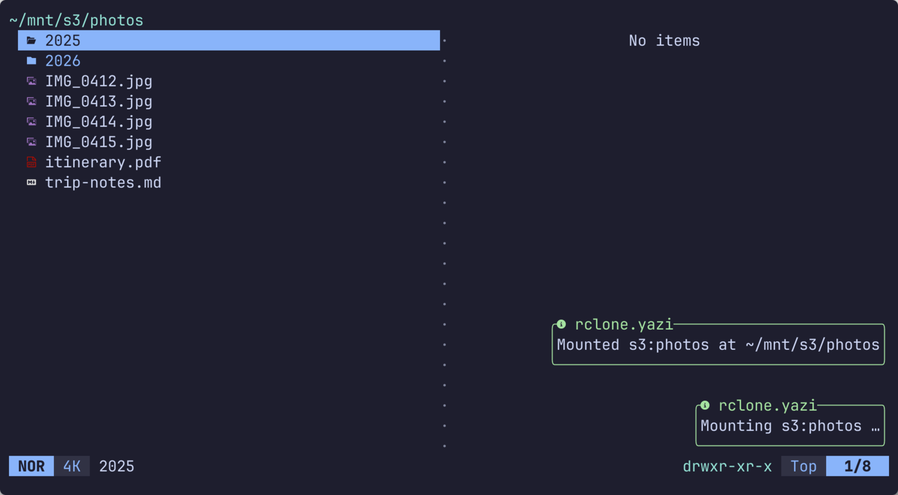

# rclone.yazi

> Mount rclone remotes from Yazi, go to the mount point, and unmount when you are done.

[](https://github.com/yazi-contrib/rclone.yazi/actions/workflows/ci.yml) [](https://github.com/yazi-contrib/rclone.yazi/releases) [](LICENSE)



## Dependencies

- [Yazi](https://yazi-rs.github.io) (the latest release)
- [rclone](https://rclone.org), with a remote set up (`rclone config`)
- On Linux, FUSE (`fuse3`). On macOS nothing else: the plugin mounts with `rclone nfsmount`, which needs no
  kernel extension and no macFUSE

## Installation

```sh
ya pkg add yazi-contrib/rclone
```

Or by hand, into the folder of your configuration of Yazi:

```sh
git clone https://github.com/yazi-contrib/rclone.yazi ~/.config/yazi/plugins/rclone.yazi
```

## Usage

Bind keys in `keymap.toml`:

```toml
[mgr]
prepend_keymap = [
  { on = ["R", "m"], run = "plugin rclone mount", desc = "Mount an rclone remote" },
  { on = ["R", "u"], run = "plugin rclone unmount", desc = "Unmount an rclone remote" },
  { on = ["R", "j"], run = "plugin rclone mounts", desc = "Go to a mounted remote" },
]
```

### Mount

`plugin rclone mount` lists the remotes of `rclone listremotes` in a menu, with a key for each. After the
remote it asks for a path in it, and an empty path is the root of the remote. The remote is mounted at
`<mount_dir>/<remote>/<path>`, and Yazi goes there. If it is mounted already, Yazi only goes there.

`s3:` with the path `my-bucket` is mounted at `~/.local/state/rclone/mnt/s3/my-bucket`.

### Unmount

`plugin rclone unmount` unmounts the mount that Yazi is in. When it is in none, a menu lists the mounts.
Yazi leaves the mount first, as a mount that is in use cannot be unmounted.

### Jump

`plugin rclone mounts` lists the mounts that are active under `mount_dir`, and Yazi goes to the one you choose.

## Configuration

Optionally, in `init.lua`:

```lua
require("rclone"):setup {
  mount_dir = "~/.local/state/rclone/mnt",
  cache_dir = "~/.cache/rclone",
  mount_args = { "--vfs-cache-mode", "full", "--allow-other" },
}
```

| Option       | Default                      | Meaning                                                              |
|--------------|------------------------------|----------------------------------------------------------------------|
| `mount_dir`  | `$XDG_STATE_HOME/rclone/mnt` | Where the remotes are mounted: `<mount_dir>/<remote>/<path>`         |
| `cache_dir`  | `$XDG_CACHE_HOME/rclone`     | The cache of the VFS of rclone, a folder for each mount              |
| `mount_args` | see below                    | The arguments for rclone, and they replace the defaults, not add to them |

Without `$XDG_STATE_HOME` and `$XDG_CACHE_HOME` the folders are `~/.local/state` and `~/.cache`, as macOS has
neither variable.

The default `mount_args` are `--vfs-cache-mode writes --vfs-cache-max-age 24h --vfs-cache-max-size 5G
--dir-cache-time 1h --poll-interval 1m --buffer-size 32M --umask 002`. `--allow-other` is not one of them: on
Linux it needs `user_allow_other` in `/etc/fuse.conf`.

A mount is found by looking in the mount table of the system for paths under `mount_dir`. A remote that is
mounted at the old path after you change `mount_dir` is not found.

## How it works, and what can break

The plugin runs `rclone mount REMOTE PATH --daemon` (`nfsmount` on macOS), and `fusermount -u` or `umount` to
unmount. The mounts are read from `mount`, whose lines look like `remote: on /path type fuse.rclone` on Linux and
`localhost:/ on /path (nfs, …)` on macOS. A remote that is slow to answer holds Yazi's task until rclone returns.
The options of `setup` are read through `ya.sync`, as the code that runs async has a Lua state of its own.

## Development

```sh
nix develop
bats tests/
```

The tests start Yazi in a detached tmux session with a configuration of its own that loads the plugin from this
folder. An `rclone` that is a script is first in the `PATH`: it lists remotes, and when it is asked to mount it
writes a line in a table that a `mount` script prints. The tests check the calls, the table and where Yazi goes,
so nothing is mounted for real. That a real mount works is not in the tests.

## The yazi-contrib ecosystem

Plugins of Yazi, one repository for each: `viewer.yazi`, `layout.yazi`, `starship.yazi`, `finder.yazi`,
`tailscale.yazi`, `rclone.yazi`.

## License

MIT
